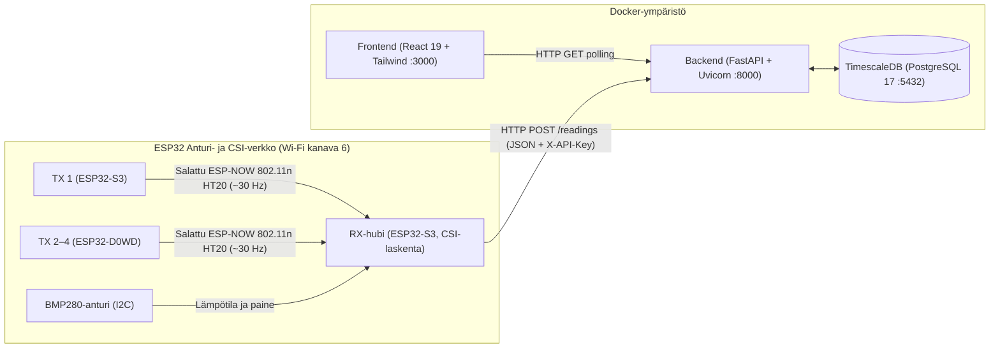

# Seurantasovellus

Opinnäytetyönä toteutettu IoT- ja web-pohjainen sisätilojen seurantasovellus. Järjestelmä mittaa ja visualisoi tilan (esim. huone, asunto tai toimisto) ympäristöolosuhteita sekä tunnistaa läsnäoloa ja liikettä **Wi-Fi CSI -signaalien (Channel State Information)** avulla ilman kameroita tai erillisiä liiketunnistimia.

Sovellus koostuu ESP32-mikrokontrollereilla toteutetusta anturi- ja CSI-verkosta, FastAPI-taustapalvelusta, TimescaleDB-aikasarjatietokannasta sekä reaaliaikaisesta React-dashboardista.

---

## Sisällysluettelo

- [Keskeiset ominaisuudet](#keskeiset-ominaisuudet)
- [Arkkitehtuuri](#arkkitehtuuri)
- [Hakemistorakenne](#hakemistorakenne)
- [Toimintaperiaate](#toimintaperiaate)
  - [Wi-Fi CSI -läsnäolotunnistus (ESP32)](#wi-fi-csi--läsnäolotunnistus-esp32)
  - [Ympäristömittaukset (BMP280)](#ympäristömittaukset-bmp280)
  - [Taustapalvelu ja REST API](#taustapalvelu-ja-rest-api)
  - [Tietokantamalli](#tietokantamalli)
  - [Web-käyttöliittymä ja huonekartta](#web-käyttöliittymä-ja-huonekartta)
- [Vaatimukset](#vaatimukset)
- [Käyttöönotto](#käyttöönotto)
  - [1. Ympäristömuuttujat](#1-ympäristömuuttujat)
  - [2. Palveluiden käynnistys Dockerilla](#2-palveluiden-käynnistys-dockerilla)
  - [3. Testidatan generointi ja live-simulointi](#3-testidatan-generointi-ja-live-simulointi)
  - [4. ESP32-laitteiden konfigurointi ja ohjelmointi](#4-esp32-laitteiden-konfigurointi-ja-ohjelmointi)
- [Testaus](#testaus)

---

## Keskeiset ominaisuudet

- **Wi-Fi CSI -pohjainen läsnäolon tunnistus:** Tunnistaa liikkeen huoneessa 1–4 lähetinsolmun (`TX`) ja keskusvastaanottimen (`RX`) välisistä 802.11n-radiokanavan alikantoaaltojen amplitudivaihteluista.
- **Ympäristöseuranta:** Lämpötilan (°C) ja ilmanpaineen (hPa) mittaus `BMP280`-anturilla (I2C) sekä tietokanta-, API- ja käyttöliittymätuki myös ilmankosteudelle (%).
- **Reaaliaikainen dashboard:**
  - Yhteenvetokortit uusimmilla arvoilla, 24 h muutoksella ja minikaavioilla (sparkline).
  - Aikasarjakaaviot (`24 h`, `7 pv`, `30 pv`) avattavassa modaalinäkymässä minimi-, keskiarvo- ja maksimitilastoilla.
  - Linjakohtainen presenssiaikajana (huone yhteensä + jokainen `TX`-linja erikseen) sekä viimeisimpien liikejaksojen loki kestotietoineen.
  - **Interaktiivinen huonekartta ja pohjapiirroseditori:** Käyttäjä voi piirtää oman huoneensa 1 m × 1 m ruudukolle, nähdä pinta-alan ja sijoitella `RX`- ja `TX`-laitteet oikeille paikoilleen. Aktiiviset liikelinjat korostuvat kartalla reaaliajassa.
  - **Järjestelmä- ja anturidiagnostiikka:** RX-hubin yhteystila (online/offline), Wi-Fi-signaalin voimakkuus (RSSI), käyttöaika (uptime) sekä anturikohtainen tilaseuranta.

---

## Arkkitehtuuri



| Komponentti | Teknologia | Rooli |
| :--- | :--- | :--- |
| **TX-solmut** | ESP-IDF 6.1 (C), ESP32-S3 / ESP32-D0WD | Lähettävät salattuja ESP-NOW-paketteja 802.11n HT20 -tilassa ~30 Hz taajuudella. |
| **RX-hubi** | ESP-IDF 6.1 (C), ESP32-S3, BMP280 | Kuuntelee CSI-tietoja, laskee linjakohtaisen varianssin, lukee BMP280-anturin ja lähettää telemetrian HTTP:llä. |
| **Backend** | Python 3.12, FastAPI, Uvicorn, Pydantic, psycopg2 | Validoi ja tallentaa mittaukset sekä tarjoaa aggregoidut aikasarja- ja presenssirajapinnat. |
| **Tietokanta** | TimescaleDB (`timescale/timescaledb:latest-pg17`) | Tallentaa mittaukset ja linjakohtaiset CSI-tulokset hypertable-aikasarjatauluihin. |
| **Frontend** | React 19, Tailwind CSS (Node 20) | Dashboard, aikasarjakaaviot, presenssiaikajana ja interaktiivinen SVG-huonekartta. |

---

## Hakemistorakenne

```text
Seurantasovellus/
├── docker-compose.yml              # Tuotanto-/peruskonfiguraatio (db, backend, frontend)
├── docker-compose.override.yml     # Kehitystilan ylikirjoitukset (hot-reload, DB-portti hostiin)
├── backend/
│   ├── main.py                     # FastAPI-sovellus ja REST-päätepisteet
│   ├── models.py                   # Pydantic-tietomallit ja arvorajavalidointi
│   ├── db.py                       # Tietokantayhteys ja TimescaleDB-skeeman alustus
│   ├── test_main.py                # API-testit (pytest)
│   ├── requirements.txt            # Python-riippuvuudet
│   ├── Dockerfile
│   └── tools/
│       └── seed_db.py              # Testidatan generointi ja live-simulaattori
├── seuranta-app/
│   ├── package.json                # React-riippuvuudet ja skriptit
│   ├── tailwind.config.js          # Tailwind CSS -asetukset ja animaatiot
│   ├── Dockerfile
│   └── src/
│       ├── App.js                  # Päänäkymä ja polling-logiikka
│       ├── api.js                  # REST-asiakas (REACT_APP_API_URL)
│       ├── hooks/                  # usePolling, useBackendStatus
│       ├── utils/                  # format.js, roomLayout.js (localStorage-pohjapiirros)
│       └── components/             # StatCard, ChartCard, ChartModal, PresenceCard,
│                                   # RoomMap, RoomEditor, EspStatusCard, SensorStatusCard
├── ESP32_WiFi_Sens_RX/             # Vastaanotin-hubin firmware (ESP32-S3)
│   └── main/
│       ├── main.c                  # Wi-Fi STA + Promiscuous + CSI-laskenta + ESP-NOW
│       ├── http_client_service.c/h # JSON-serialisointi ja HTTP POST -lähetys
│       └── bmp280.c/h              # I2C-ajuri BMP280/BME280-anturille
├── ESP32_WiFi_Sens_TX/             # Lähetinsolmun firmware (ESP32-S3)
│   └── main/main.c
└── ESP32_WiFi_Sens_TX_D0WD/        # Lähetinsolmun firmware (ESP32 / ESP32-D0WD)
    └── main/main.c
```

---

## Toimintaperiaate

### Wi-Fi CSI -läsnäolotunnistus (ESP32)

1. **Lähetys (TX-solmut):**
   - Lähetinsolmut (`ESP32_WiFi_Sens_TX` ESP32-S3:lle ja `ESP32_WiFi_Sens_TX_D0WD` perinteiselle ESP32-D0WD:lle) lukitaan Wi-Fi-kanavalle `6` (`SENSING_CHANNEL`).
   - Lähetys pakotetaan 802.11n (`HT20`, `MCS0_LGI`) -tilaan, jotta vastaanotin saa OFDM/HT-muotoisen CSI-tiedon.
   - Paketit lähetetään salattuna ESP-NOW-protokollalla (PMK- ja LMK-avaimet) noin **30 Hz** taajuudella (33 ms välein). `ESP32_WiFi_Sens_TX_D0WD`-firmware porrastaa eri solmujen käynnistyksen (`(TX_NODE_ID - 1) * 11 ms`) ja käyttää `vTaskDelayUntil`-ajastusta radioliikenteen törmäysten minimoimiseksi.

2. **Vastaanotto ja laskenta (RX-hubi):**
   - Vastaanotin (`ESP32_WiFi_Sens_RX`) yhdistää Wi-Fi-verkkoon samalla kanavalla (`6`) ja aktivoi samanaikaisesti Promiscuous- ja CSI-tilan (`CONFIG_ESP_WIFI_CSI_ENABLED=y`).
   - Kun paketti saapuu tunnetusta `TX`-MAC-osoitteesta, `wifi_csi_rx_cb` laskee 64 alikantoaallon amplitudit ($\sqrt{\text{Re}^2 + \text{Im}^2}$) ja tallentaa ne solmukohtaiseen 30 näytteen liukuvaan ikkunaan (`WINDOW_SIZE = 30`).
   - Kun puskuri on täynnä, lasketaan alikantoaaltojen keskimääräinen amplitudivarianssi käyttökelpoisilta alikantoaalloilta (`sc = 6..27` ja `37..57`, suodattaen pois suoja- ja DC-alikantoaallot).
   - Linjan läsnäolotilaksi asetetaan `presence = true`, kun varianssi ylittää kynnysarvon `VARIANCE_THRESHOLD = 3.5`.

3. **Telemetrian lähetys:**
   - Laskentakutsu ei tee verkkokutsuja keskeytyskäsittelijässä, vaan välittää tulokset FreeRTOS-jonon (`s_telemetry_queue`) kautta erilliselle `telemetry_task`-tehtävälle (Core 1).
   - Uusi HTTP POST lähetetään heti minkä tahansa linjan tilan muuttuessa (vähintään 500 ms välein) tai säännöllisesti 15 sekunnin välein elossaolon merkiksi.

### Ympäristömittaukset (BMP280)

RX-hubissa on sisäänrakennettu I2C-ajuri (`bmp280.c/h`), joka:
- Käyttää oletuksena pinnejä `SDA = GPIO 8` ja `SCL = GPIO 9` (100 kHz).
- Tunnistaa automaattisesti anturin I2C-osoitteen (`0x76` tai `0x77`) sekä sirun tunnisteen (`0x58` BMP280 / `0x60` BME280).
- Toimii vikasietoisesti: jos anturia ei ole kytketty, RX-hubi jatkaa normaalia CSI-toimintaa ja jättää `temperature`- ja `pressure`-kentät pois JSON-sanomasta (tietokantaan tallentuu `NULL`).

### Taustapalvelu ja REST API

FastAPI-palvelu kuuntelee portissa `8000` (interaktiivinen OpenAPI/Swagger-dokumentaatio osoitteessa `http://localhost:8000/docs`).

| Metodi | Päätepiste | Kuvaus |
| :--- | :--- | :--- |
| `GET` | `/status` | Tarkistaa backendin tilan ja tietokantayhteyden (TimescaleDB-version). |
| `POST` | `/readings` | Vastaanottaa RX-hubin lähettämän mittauksen. Suojattavissa `DEVICE_API_KEY`-avaimella (`X-API-Key`- tai `X-Device-Key`-otsikko). |
| `GET` | `/readings/latest` | Palauttaa uusimman mittauksen, linjakohtaiset tulokset, mittauksen iän (`age_s`) ja `online`-tilan (`age_s <= 90 s`). |
| `GET` | `/readings` | Palauttaa `time_bucket`-aggregoidun aikasarjan. Parametri `range`: `24h` (30 min), `7d` (2 h) tai `30d` (6 h). |
| `GET` | `/presence/timeline` | Palauttaa linjakohtaisen (`tx_id`) presenssiaikajanan ja maksimivarianssin samoilla aikajaksoilla kuin `/readings`. |
| `GET` | `/presence/recent` | Koostaa viimeisen 24 h yhtenäiset liikejaksot (alku, loppu, kesto, käynnissä-tila ja havainneet `tx_ids`). Parametri `limit` (1–50, oletus 5). |

Kaikki `GET`-mittauspäätepisteet tukevat valinnaista `device_id`-kyselyparametria.

**Esimerkki `POST /readings` -pyynnön rungosta:**

```json
{
  "device_id": "RX_S3_HUB",
  "temperature": 22.4,
  "humidity": 46.0,
  "pressure": 1012.3,
  "rssi": -56,
  "uptime_s": 534720,
  "links": [
    { "tx_id": 1, "variance": 1.8, "presence": false },
    { "tx_id": 2, "variance": 4.6, "presence": true },
    { "tx_id": 3, "variance": 2.1, "presence": false },
    { "tx_id": 4, "variance": 1.5, "presence": false }
  ]
}
```

> **Huom:** Jos `motion`-kenttä jätetään pois ja `links` on mukana, backend päättelee huoneen liiketilan automaattisesti (`motion = true`, jos yksikin linja raportoi `presence = true`). Pydantic hylkää epärealistiset arvot (esim. lämpötila `-40..85 °C`, kosteus `0..100 %`, paine `300..1100 hPa`, RSSI `-120..0 dBm`).

### Tietokantamalli

Backend alustaa käynnistyessään (`init_schema`) kaksi TimescaleDB-hypertablea:

- **`readings`**: `time` (TIMESTAMPTZ), `device_id`, `temperature`, `humidity`, `pressure`, `motion`, `rssi`, `uptime_s`
- **`link_readings`**: `time` (TIMESTAMPTZ, sama aikaleima kuin vastaavalla `readings`-rivillä), `device_id`, `tx_id`, `variance`, `presence`

### Web-käyttöliittymä ja huonekartta

- **Automaattinen päivitys:** Uusin mittaus (`/readings/latest`) ja viimeisimmät havainnot (`/presence/recent`) haetaan 1 sekunnin välein; 24 tunnin kaaviot ja aikajanat 60 sekunnin välein.
- **Huonekartta (`RoomMap` & `RoomEditor`):**
  - Piirrä vapaamuotoinen huone 20 m × 14 m ruudukolle (seinät tarttuvat 0,5 m ja laitteet 0,25 m välein).
  - Kulmia voi lisätä (`+`), siirtää ja poistaa (tuplaklikkaus), ja pinta-ala lasketaan automaattisesti.
  - Pohjapiirros ja laitteiden sijainnit tallentuvat selaimen `localStorage`-muistiin avaimella `seuranta.roomLayout.v2`.
  - Kun jonkin `TX`-linjan presenssi aktivoituu, kyseinen linja ja sen vaikutusalue hehkuvat vihreänä kartalla.

---

## Vaatimukset

### Ohjelmistot
- **Docker** ja **Docker Compose** (suositeltu tapa palveluiden ajamiseen)
- *(Valinnainen, jos ajetaan ilman Dockeria)*: Python 3.12+, Node.js 20+ (npm), PostgreSQL 17 + TimescaleDB-laajennus
- **ESP-IDF 6.1** (ESP32-firmwarejen kääntämiseen ja flashaamiseen)

### Laitteisto (fyysinen käyttöönotto)
- **1 × ESP32-S3** vastaanotin-hubiksi (`ESP32_WiFi_Sens_RX`)
- **1–4 × lähetinsolmua:** ESP32-S3 (`ESP32_WiFi_Sens_TX`) ja/tai ESP32-D0WD (`ESP32_WiFi_Sens_TX_D0WD`)
- *(Valinnainen)* **BMP280** (tai BME280) -ympäristöanturi I2C-liitännällä (3,3 V)
- **2,4 GHz Wi-Fi-tukiasema**, jonka radiokanava vastaa firmwaren `SENSING_CHANNEL`-asetusta (oletus kanava `6`), jotta RX-hubi voi kuunnella CSI-paketteja ja välittää datan backendille samanaikaisesti.

> Sovellusta voi käyttää ja kehittää täysin myös **ilman fyysisiä ESP32-laitteita** mukana tulevan simulaattorityökalun (`backend/tools/seed_db.py`) avulla.

---

## Käyttöönotto

### 1. Ympäristömuuttujat

Luo tai tarkista seuraavat `.env`-tiedostot ennen käynnistystä (älä vie tuotantosalaisuuksia versionhallintaan).

**Projektin juuri (`.env`):**
```env
POSTGRES_USER=seuranta
POSTGRES_PASSWORD=vaihda_salasana
POSTGRES_DB=seuranta_db
DATABASE_URL=postgresql://seuranta:vaihda_salasana@db:5432/seuranta_db
DB_PORT=5432
BACKEND_PORT=8000
FRONTEND_PORT=3000
CORS_ORIGINS=http://localhost:3000
```

**Backend (`backend/.env`):**
```env
# Valinnainen: jos asetettu, POST /readings vaatii vastaavan arvon X-API-Key- tai X-Device-Key-otsikossa
DEVICE_API_KEY=oma_salainen_laiteavain
```

**Frontend (`seuranta-app/.env`):**
```env
REACT_APP_API_URL=http://localhost:8000
WATCHPACK_POLLING=true
```

### 2. Palveluiden käynnistys Dockerilla

Käynnistä tietokanta, backend ja frontend projektin juurihakemistosta:

```bash
docker compose up --build
```

Kehitysympäristössä `docker-compose.override.yml` latautuu automaattisesti, mikä ottaa käyttöön backendin ja frontendin hot-reloadin sekä jakaa tietokannan portin host-koneelle.

Palvelut käynnistymisen jälkeen:
- **Dashboard (Frontend):** `http://localhost:3000`
- **Backend API:** `http://localhost:8000`
- **API-dokumentaatio (Swagger):** `http://localhost:8000/docs`
- **Tilan tarkistus:** `http://localhost:8000/status`

Sammuttaminen:
```bash
docker compose down
```

### 3. Testidatan generointi ja live-simulointi

Voit täyttää tietokannan realistisella 30 päivän historialla ja simuloida RX-hubin reaaliaikaista lähetystä `backend/tools/seed_db.py` -työkalulla:

```bash
# Tyhjennä taulut ja generoi 30 vrk historiaa (4 TX-linjaa, katkokset, vuorokausirytmi)
docker compose exec backend python tools/seed_db.py --clear

# Generoi historia ja jää lähettämään live-dataa 30 s välein (Ctrl+C lopettaa)
docker compose exec backend python tools/seed_db.py --clear --live

# Testaa huonekarttaa: liike kiertää TX 1 -> TX 2 -> TX 3 -> TX 4 joka 5. sekunti
docker compose exec backend python tools/seed_db.py --days 0 --live 5 --cycle

# Testaa puuttuvaa anturia (näkyy "Sensorien tila" -kortissa vikana) ja aktiivista liikettä
docker compose exec backend python tools/seed_db.py --clear --end occupied --missing humidity
```

Kaikki valitsimet saa näkyviin komennolla:
```bash
docker compose exec backend python tools/seed_db.py --help
```

### 4. ESP32-laitteiden konfigurointi ja ohjelmointi

Ennen firmwaren kääntämistä päivitä verkkosi ja laitteidesi tiedot lähdekoodeihin:

1. **Selvitä MAC-osoitteet:** Lue kunkin ESP32-laudan Wi-Fi STA MAC-osoite (esim. `esptool.py read_mac` tai sarjamonitorista).
2. **Konfiguroi RX-hubi (`ESP32_WiFi_Sens_RX`):**
   - `main/main.c`: Aseta `WIFI_SSID`, `WIFI_PASS`, `SENSING_CHANNEL` (vastattava Wi-Fi-reitittimen kanavaa), `NUM_TX_NODES`, lähettimien MAC-osoitteet (`s_TX_mac`) sekä 16-merkkiset ESP-NOW-salausavaimet (`PMK_KEY_STR`, `LMK_KEY_STR`).
   - `main/http_client_service.c`: Aseta `SERVER_URL` (backend-koneen lähiverkko-IP, esim. `http://192.168.1.50:8000`) ja `DEVICE_API_KEY` (sama kuin `backend/.env`:ssä).
   - `main/bmp280.h`: Tarkista tarvittaessa I2C-pinnit (`I2C_MASTER_SDA_IO`, `I2C_MASTER_SCL_IO`).
3. **Konfiguroi TX-solmut (`ESP32_WiFi_Sens_TX` ja/tai `ESP32_WiFi_Sens_TX_D0WD`):**
   - `main/main.c`: Aseta vastaanottimen MAC-osoite (`s_RX_mac`), sama `SENSING_CHANNEL`, samat `PMK_KEY_STR` ja `LMK_KEY_STR` -avaimet sekä jokaiselle laudalle yksilöllinen `TX_NODE_ID` (`1`, `2`, `3`, `4`).
4. **Käännä ja flashaa (ESP-IDF-komentorivillä):**

```bash
# RX-hubi (ESP32-S3)
cd ESP32_WiFi_Sens_RX
idf.py set-target esp32s3
idf.py build flash monitor

# TX-solmu (ESP32-S3)
cd ../ESP32_WiFi_Sens_TX
idf.py set-target esp32s3
idf.py build flash monitor

# TX-solmu (ESP32-D0WD)
cd ../ESP32_WiFi_Sens_TX_D0WD
idf.py set-target esp32
idf.py build flash monitor
```

---

## Testaus

Backendin API-testit voidaan ajaa kontissa `pytest`-työkalulla:

```bash
docker compose exec backend pytest
```

Frontendin testit:

```bash
docker compose exec frontend npm test
```
